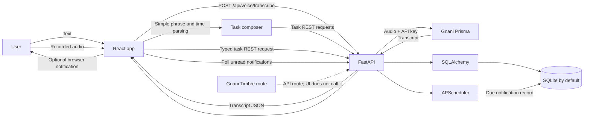

# LuuVi

<p align="center"></p>

### Your Personal AI Productivity Assistant.

LuuVi gives everyday tasks a calm place to land. Add tasks with text or your voice, set a due time, and keep an eye on reminders from one focused workspace.

[](https://github.com/windchime0805/voca-ai-assistant)

> **Project status:** LuuVi is an actively developed prototype. Tasks and reminder records are stored by the backend; voice transcription requires a Gnani API key. The sign-in screen is a local demo gate, not account authentication.

<!-- Add a project banner here when a final shareable asset is available. -->

## Why LuuVi?

Tasks, notes, calendars, and reminders often end up scattered across apps. That makes quick capture harder, especially when typing is inconvenient. Voice input can make task capture more accessible and reduce the steps between remembering something and writing it down.

## The approach

LuuVi brings a text and voice task composer together with a persistent task list and scheduled reminders. The browser records audio, the backend sends it to Gnani Prisma for transcription, and a small client-side parser recognizes common task phrases and times. The backend stores tasks and creates notification records when reminders are due.

LuuVi does **not** currently use an AI reasoning agent to plan tasks or operate a calendar. The current voice workflow is transcription plus deterministic parsing.

## Features

- **Text and voice task capture.** Type a task or record a short voice note. Voice transcription uses Gnani Prisma and English (`en-IN`) by default.
- **Task management.** Create, complete, filter, and delete tasks with categories, priorities, due dates, and due times. The API also supports task updates.
- **Common spoken time parsing.** Recognizes phrases such as “tomorrow,” “in 20 minutes,” and “at 4 pm.” Check the task details after capture when a time could be ambiguous.
- **Scheduled reminders.** APScheduler creates persistent notification records at a task’s reminder time. The open app polls for alerts; optional browser notifications require browser permission and the app to be open.
- **Daily workspace.** Review daily tasks, progress, and a task calendar view; switch between day and night themes.
- **Quick notes.** Notes are stored in that browser’s local storage and are not synced to the backend.
- **Backend speech generation route.** A Gnani Timbre endpoint is available in the API, but the frontend does not currently use it for spoken replies.

### Not implemented yet

Real user accounts, AI reasoning or agent actions, external calendar sync, cloud note sync, automatic action-item extraction, and background push notifications are not connected. There is no Evon or other reasoning-provider integration.

## Screenshots and demo

No shareable screenshots or demo video are included yet. Add real captures to the paths below before publishing them:

| Screen | Image |
| --- | --- |
| Dashboard | `docs/screenshots/dashboard.png` |
| Voice assistant | `docs/screenshots/voice-assistant.png` |
| Task management | `docs/screenshots/tasks.png` |
| Reminders and scheduling | `docs/screenshots/reminders.png` |
| Night mode | `docs/screenshots/night-mode.png` |

**Demo video:** _Add the final demo video URL here._

## Technology stack

| Area | Technologies and role |
| --- | --- |
| Frontend | React and React DOM `^18.3.1`, TypeScript `^5.7.2`, Vite `^6.0.1`, Vite React plugin `^4.3.4`, and Lucide `^0.468.0`; the lockfile records resolved versions. |
| Backend | Python 3.10+; FastAPI `>=0.115,<1.0`, Uvicorn `>=0.30,<1.0`, Pydantic Settings `>=2.4,<3.0`, SQLAlchemy `>=2.0,<3.0`, HTTPX `>=0.27,<1.0`, and python-multipart `>=0.0.9,<1.0`. |
| Speech | Gnani Prisma handles speech-to-text through the backend. Gnani Timbre has a backend text-to-speech route that is not called by the current UI. |
| Database | SQLite by default, via SQLAlchemy. Other database URLs require the matching SQLAlchemy driver to be installed separately. |
| Scheduling | APScheduler `>=3.10,<4.0` runs reminder jobs in the backend process and saves due alerts to the database. |
| Development | npm, Vite, Uvicorn, and Python virtual environments. |

The backend dependency ranges are not locked to exact patch versions. Use Node.js 20+ and Python 3.10+.

## How it works



## Run locally

### Requirements

- Git
- Node.js 20+ and npm
- Python 3.10+
- A Gnani API key for voice transcription (text task features work without one)

### 1. Clone the repository

```powershell
git clone https://github.com/windchime0805/voca-ai-assistant.git
cd voca-ai-assistant
```

### 2. Configure and start the backend

```powershell
cd backend
python -m venv .venv
.\.venv\Scripts\Activate.ps1
python -m pip install -r requirements.txt
Copy-Item .env.example .env
```

Edit `backend/.env` and set `GNANI_API_KEY` if you want voice transcription or the Timbre speech endpoint. Keep the key in the backend environment; do not add it to frontend code or a `VITE_` variable.

Start the API from the `backend/` directory:

```powershell
uvicorn app.main:app --reload --port 8001
```

### 3. Install and start the frontend

Open a second terminal at the repository root:

```powershell
cd frontend
npm install
npm run dev
```

Open [http://localhost:5173](http://localhost:5173) and choose the local demo option. Vite forwards `/api` requests to `http://127.0.0.1:8001`.

The API health check is [http://localhost:8001/api/health](http://localhost:8001/api/health), and interactive OpenAPI documentation is at [http://localhost:8001/docs](http://localhost:8001/docs).

## Environment variables

Create `backend/.env` from `backend/.env.example`. The example contains placeholders only. Values are read by the backend; no API credential belongs in the frontend.

| Variable | Purpose | Required? |
| --- | --- | --- |
| `GNANI_API_KEY` | Gnani credential used by Prisma transcription and the Timbre API route. | Optional for text tasks; required for speech services. |
| `DATABASE_URL` | SQLAlchemy database connection. Defaults to `sqlite:///./voca.db` from the backend working directory. | Optional. |
| `CORS_ORIGINS` | Comma-separated browser origins allowed by the API. Defaults to `http://localhost:5173`. | Optional for local setup. |
| `PRISMA_MODEL` | Prisma transcription model; defaults to `prisma-v3.0`. | Optional. |
| `PRISMA_LANGUAGE` | Default transcription language; defaults to `en-IN`. | Optional. |
| `TIMBRE_MODEL` | Timbre speech model; defaults to `timbre-v2.5`. | Optional; only used by the speech route. |
| `TIMBRE_VOICE` | Timbre voice; defaults to `Kaveri`. | Optional; only used by the speech route. |
| `TIMBRE_LANGUAGE` | Timbre language; defaults to `en-IN`. | Optional; only used by the speech route. |
| `DEMO_MODE` | Demo status value returned by `/api/status`; it does not enable authentication. | Optional; defaults to `true`. |

The scheduler currently uses UTC internally. The UI converts local task times before sending them to the API.
The database filename retains its earlier name so existing local task data continues to load.

## API overview

All routes are served by the FastAPI backend. Open `/docs` for the live request and response schemas.

| Method | Path | Purpose |
| --- | --- | --- |
| `GET` | `/api/health` | Basic health response. |
| `GET` | `/api/status` | Feature and integration configuration flags. |
| `POST` | `/api/voice/transcribe` | Multipart audio transcription (`audio_file`, optional `language_code`). |
| `POST` | `/api/voice/speak` | Accepts JSON `{ "text": "..." }` and returns WAV audio through Gnani Timbre. |
| `GET` | `/api/tasks` | List tasks; supports `status` and `due_date` filters. |
| `POST` | `/api/tasks` | Create a task. |
| `PUT` | `/api/tasks/{task_id}` | Update task fields, including completion status. |
| `DELETE` | `/api/tasks/{task_id}` | Delete a task and its notifications. |
| `GET` | `/api/notifications` | List notifications; `unread_only` defaults to `true`. |
| `PUT` | `/api/notifications/{notification_id}/read` | Mark a notification as read. |

Create a task with a reminder:

```http
POST /api/tasks
Content-Type: application/json
```

```json
{
  "title": "Review notes",
  "category": "Study",
  "priority": "Medium",
  "due_date": "2026-11-10",
  "due_time": "16:00:00",
  "notification_at": "2026-11-10T10:30:00Z"
}
```

Task creation requires a non-empty title. Priorities are `Low`, `Medium`, `High`, or `Urgent`; the schemas also accept optional descriptions.

## Project structure

```text
.
├── backend/
│   ├── app/
│   │   ├── models/       # SQLAlchemy task and notification models
│   │   ├── routes/       # FastAPI task, notification, and voice routes
│   │   ├── schemas/      # Pydantic request and response schemas
│   │   ├── services/     # Prisma, Timbre, and reminder scheduler
│   │   ├── config.py     # Backend settings
│   │   ├── database.py   # Engine, sessions, and schema initialization
│   │   └── main.py       # FastAPI app and lifecycle
│   ├── .env.example      # Safe environment template
│   └── requirements.txt
├── frontend/
│   ├── public/            # LuuVi favicon/logo asset
│   ├── src/              # React app and styles
│   ├── index.html
│   ├── package.json
│   └── vite.config.ts
├── .gitignore
├── LICENSE
└── README.md
```

## Security and privacy

- Keep `GNANI_API_KEY` in the backend `.env`. The backend sends it to Gnani; the browser never needs to receive it.
- `.gitignore` excludes local `.env` files, virtual environments, databases, build output, caches, logs, and editor metadata. The safe `.env.example` remains tracked.
- The demo sign-in is only a browser-side screen gate. The API currently has no authentication or authorization, so do not expose a deployed instance containing private user data.
- Task text and reminder records are stored in the configured database. Notes are stored in browser local storage. Voice audio is sent to the configured speech provider for transcription.
- The API validates task fields with Pydantic, but this prototype is not a hardened multi-user service.

## Contributing

Issues and pull requests are welcome. Before proposing a change, describe the behavior it affects and keep documentation aligned with what the app actually does. Do not commit `.env` files, private databases, or build output. Run the frontend build and any relevant checks before opening a pull request.

## License

LuuVi is released under the [MIT License](LICENSE).

## Acknowledgements

Speech integrations use Gnani AI’s Prisma and Timbre services. The application also uses React, TypeScript, Vite, FastAPI, SQLAlchemy, APScheduler, Pydantic, and Lucide icons.
